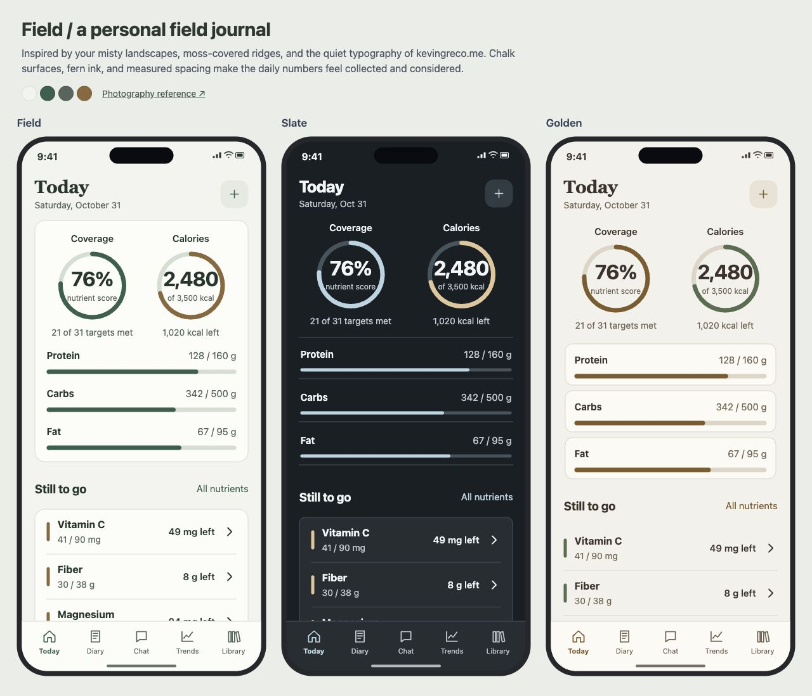
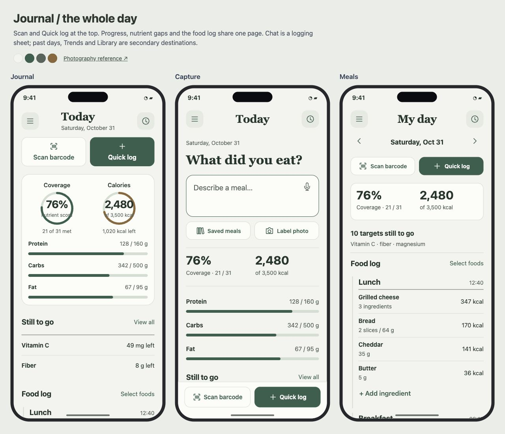

# Nutrient

**A native iOS nutrition tracker built around nutrient coverage.**

Log food in plain language, scan a barcode or nutrition label, and see which nutrients you have covered—and which still need attention. Nutrient combines a SwiftUI iPhone app, a bundled food database, and an optional AI assistant. Nutrient tracking and historical views have no subscription gate.

## Features

- **Today at a glance:** nutrient-coverage and calorie rings, plus protein, carbohydrate, and fat progress bars.
- **34 tracked nutrients:** macros, vitamins, minerals, fiber, choline, and omega-3, with editable targets. Tap a nutrient to see how much each logged food contributed.
- **Visible daily gaps:** surface unmet reported targets and ask the assistant for foods that could help close them.
- **Conversational logging:** describe or dictate a meal, review the proposed foods and portions, then confirm to log it.
- **Barcode scanning:** native camera lookup of packaged foods through Open Food Facts. Scan successive ingredients into one meal draft, adjust each portion, and log them together as a named meal. Mix scans with database foods and optionally save the meal for reuse.
- **Nutrition-label photos:** photograph a Nutrition Facts panel or choose an existing photo to prefill a custom food. Review the extracted serving, calories, and nutrient amounts before saving.
- **Measurement conversion:** enter grams, ounces, pounds, kilograms, or available food-specific measures such as cups, tablespoons, slices, and pieces. See the gram equivalent while calories and nutrients update.
- **Reusable library:** save custom foods, meals, and supplements. Select existing diary entries to save a meal with their logged portions. Edit diary entries and portions; archive library items while keeping historical entries intact.
- **Daily, weekly, and monthly trends:** individual-day scores, Monday–Sunday weekly averages, and monthly nutrient/calorie averages. Choose a time range and read exact dated values alongside target comparisons.
- **Local storage:** diary, targets, and library persist on the device, with JSON export/import.

The iPhone interface is written in **SwiftUI**, using native navigation, tabs, forms, camera capture, and charts. A separate Vite web companion shares nutrition data and server modules. Web assets are not embedded in the iOS app.

## Run the iOS app

You need macOS, Xcode with an iOS SDK, and an Apple signing team to run on a physical iPhone. The minimum deployment target is **iOS 17**. Node.js 20.19+ or 22.12+ and npm are used for the shared data/build tooling.

```sh
git clone https://github.com/kggreco11/nutrient.git
cd nutrient
npm ci
npm run ios:open
```

In Xcode:

1. Select the **App** target in `ios/App/App.xcodeproj`.
2. Set your signing team and a bundle identifier you control under **Signing & Capabilities**.
3. Select an iPhone simulator or connected iPhone and run.

The bundled food data is already checked in. After changing shared food data or target definitions, refresh the native resources with:

```sh
npm run ios:sync
```

Manual logging, nutrient views, and trends work without an AI key. Chat and label conversion require a configured backend; barcode lookup requires internet access.

### Backend configuration

The native app currently points to this project's private hosted backend. Forks should deploy their own backend and update `origin` in [`NativeBackend.swift`](ios/App/App/NativeBackend.swift).

- Keep `OPENROUTER_API_KEY` on the server.
- Configure authentication for your deployment. Standalone deployments support a separate `NUTRIENT_API_TOKEN`; the private Sites deployment uses its service-access credential.
- The app's **More → Settings → Chat connection** stores the service-access credential in iOS Keychain. Use the credential appropriate to your chosen authentication mechanism; it is never the OpenRouter key. Adapt the request authorization header in `NativeBackend.swift` if you use standalone bearer-token authentication instead of Sites.

The checked-in Xcode project contains development signing identifiers, not signing certificates or private keys. Camera and microphone features need the corresponding iOS permissions.

## Run the web companion

```sh
npm ci
cp .env.example .env.local
npm run dev
```

Open the local URL Vite prints. For AI features, set `OPENROUTER_API_KEY` in `.env.local` and restart the dev server. The file is ignored by Git. Hosted deployments need their own server runtime secrets; local environment files are not uploaded.

```dotenv
OPENROUTER_API_KEY=your_key_here
OPENROUTER_MODEL=deepseek/deepseek-v4.1-flash
```

The default model is **DeepSeek V4.1 Flash via OpenRouter**, routed to OpenInference FP4 without a fixed token-price cap. Model selection is configured server-side. Model requests and optional web tools incur provider charges; the app does not include API credits.

```sh
npm run build
```

This builds `dist/client` for the web companion and `dist/server/index.js` for the hosted Worker. The existing hosting manifest belongs to this project's private deployment; replace it when deploying your own instance.

## How food lookup works

1. The model interprets the meal description and searches saved foods and the bundled USDA database first.
2. Barcode requests use Open Food Facts. If an exact product is missing, the assistant can propose a clearly labeled comparable-food estimate.
3. When needed, a database lookup can unlock web search and page/PDF retrieval for public manufacturer or restaurant nutrition sources.
4. The server validates food IDs, portions, and source references. App code calculates nutrition totals.
5. The app shows a review. **Only your confirmation writes the diary entry.**

The assistant can also answer user-triggered questions about the selected day's gaps. Recommendations do not automatically log food. There are no background AI monitoring or analysis jobs.

Label photos use **Apple Vision OCR on the device**, then send the recognized text to the backend for structured extraction with the selected model. Missing or unreadable nutrients stay unknown; percent Daily Values are not substituted for absolute amounts.

See the [assistant contract](docs/assistant.md), [runtime instructions](server/policy.js), and [label extraction module](server/label.js).

## Nutrition data and calculations

**USDA FoodData Central / SR Legacy** supplies 7,793 bundled food records. Food-specific household measures are available for 7,526 of them. Nutrient values use a 100 g basis; measurement conversions retain the source food's portion weights. Ounces and pounds use exact mass conversions. Volume and item counts need a food-specific weight; the app does not assume every food has water's density. Custom labels can include a serving weight in grams.

The dataset is the final **April 2018 SR Legacy release**, including historical restaurant entries. It is not a live restaurant-menu database. Source details and the archive checksum are in the [data manifest](public/data/usda-manifest.json). Packaged-product lookup uses [Open Food Facts](https://world.openfoodfacts.org/); community records can be incomplete.

Rebuild the USDA data with Python 3:

```sh
python3 scripts/import-usda.py
# Or use a previously downloaded official archive:
python3 scripts/import-usda.py /path/to/FoodData_Central_sr_legacy_food_csv_2018-04.zip
npm run ios:sync
```

The overall coverage score averages **31 capped nutrient percentages**; the three macros and calories are displayed separately. Exceeding one target cannot offset another nutrient's shortfall. Unreported amounts remain `null`, distinct from a reported zero. Coverage is a comparison with editable intake targets, not a clinical assessment or an upper-limit safety score.

The checked-in targets and supplement examples reflect this project's initial configuration. Adjust them for your own use in Settings. Background and sources are recorded in the [nutrition research notes](docs/sports-nutrition-targets.md).

## Development

```sh
npm test                 # JavaScript calculation, data, API, and assistant tests
npm run test:native      # Swift model, OCR, conversion, persistence, and contrast checks
npm run build            # Web and hosted backend build
```

Native checks require Xcode and a booted iOS simulator. The Swift test script currently targets an Apple Silicon simulator.

| Location | Purpose |
| --- | --- |
| `ios/App/App/NativeApp.swift` | SwiftUI screens and logging flows |
| `ios/App/App/NativeModels.swift` | Local persistence, nutrient calculations, and measurement conversion |
| `ios/App/App/NativeCapture.swift` | Barcode camera, label OCR, and dictation |
| `ios/App/App/NativeBackend.swift` | Native networking and Keychain access |
| `server/` | Assistant tools, label extraction, selected-day arithmetic, and API routes |
| `app/` | Web companion and shared data definitions |
| `public/data/` | Bundled USDA dataset and provenance |
| `tests/` | JavaScript tests and native model checks |

Some unused Capacitor migration files remain in the repository. The active iOS target runs SwiftUI directly and does not link the Capacitor runtime.

Issues and pull requests are welcome. Include reproduction steps for bugs, keep unknown nutrition distinct from zero, and keep provider credentials out of client code and commits.

## iPhone design directions

The [design review](design/2026-10-31/research.md) compares three directions inspired by Kevin’s [photography](https://kevingreco.me/photography): **Field**, **Slate**, and **Golden**. Field is implemented in the native SwiftUI app, with light/dark colors, short serif titles, readable food rows, nutrient filters, and a fixed meal confirmation action. The latest revision removes the bottom tabs and puts Scan barcode and Quick log directly on the daily home.



The interactive review includes 22 screen states for each direction. Run it locally:

```sh
python3 -m http.server 5188 --bind 127.0.0.1 --directory design/2026-10-31
```

Open `http://127.0.0.1:5188/`. The HTML files are design-review artifacts; the shipping iOS UI is SwiftUI. See the [verification record](design/2026-10-31/verification.md) for the checks performed and remaining device checks.

The [latest layout review](design/2026-10-31/navigation-notes.md) compares **Journal**, **Capture**, and **Meals** using the same palette and different page structures. Open `http://127.0.0.1:5188/navigation.html` after starting the review server.


