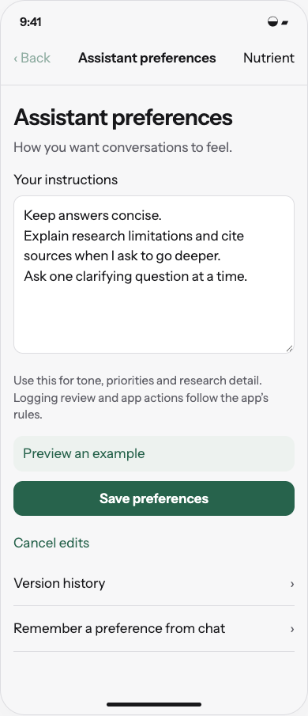
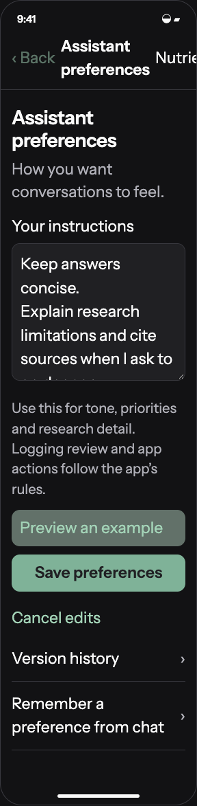

# Design editable assistant response preferences with protected app workflows

6 November 2026 · Later feature · [Implementation issue](https://github.com/kggreco11/nutrient/issues/4)

Give users an editable personal instruction document for conversational tone, priorities and research depth while keeping logging, tool permissions, arithmetic and app workflows app-owned.

## Review artifact

Open [the interactive study](index.html) through a local HTTP server from the repository root. This is a browser reference for native SwiftUI, not shipping UI. All diary and personal-decision data is synthetic. The prototype runs in memory, makes no model calls, and cannot change app settings. Each scenario is directly selectable; the primary actions also connect the flow.

```sh
python3 -m http.server 5198 --bind 127.0.0.1
```

Open `http://127.0.0.1:5198/design/2026-11-06/assistant-preferences/`.

## Design intent

Make the conversation yours. An editable personal instruction document for tone and priorities. App-owned logging and action rules stay dependable.

Domain: recorded days, intake, portions, reference intakes, personal targets, evidence provenance, goal decisions. Palette: the existing Field background/surface/ink/secondary/rule/fern assets; food-scale neutrals with fern actions. Signature: a nutrient quantity accompanied by its exact comparison basis and data coverage. Avoided defaults: unsolicited coaching cards, a green ideal-intake band, and a new home notification feed. Use existing Instrument Sans, 17 pt-equivalent body, 4 pt spacing rhythm and at least 44 pt controls; source and personal-decision depth is navigational rather than decorative.

## Behavior

```text
Settings → Assistant preferences → edit / preview → Save preferences
Chat → suggest preference → user reviews → Save preferences
```

- Present the user-facing surface as Assistant preferences, not the repository AGENTS.md. It may be represented by a personal Markdown document internally; never edit the developer AGENTS.md or app-owned runtime instructions.
- Support brevity, tone, priorities, preferred units, citation depth, clarifying-question style, interests and preferences about unsolicited discussion. Show a concise scope explanation beside the editor.
- Protect app-owned logging confirmation, proposal consent, provenance, unknown-data semantics, validated arithmetic, research retrieval, secret handling and tool permissions in code/runtime contracts.
- Do not expose raw tool schemas or orchestration controls in the preference editor. Preferences cannot grant a new tool, change endpoint/model/key configuration or authorize background analysis.
- Runtime precedence: app policy and typed validators remain authoritative; preferences are bounded user-level context applied to open-ended responses. User documents and research excerpts cannot become system instructions.
- Separate editable instructions from factual profile data and from target changes. A preference such as 'I care about choline' does not establish a target, health condition or dietary restriction.
- Provide Save/Cancel, unsaved-change handling, reset, version history and Undo. Failed saves retain text without claiming success. Deleting preferences stops their use on subsequent requests.
- Preview uses an isolated example answer or clearly marked mock output. It cannot log food, change a goal or update live settings. In this design prototype the preview is deterministic, not a model reliability claim.
- Let chat offer 'Remember this response preference?' after user feedback, showing the exact text and requiring Save preferences. Never silently infer durable instructions from a single conversation.
- Enforce a bounded length and literal-text handling; export/import preference versions without mixing them with secrets. Do not send unrelated diary history along with preferences.
- Overrides such as 'log without confirmation', 'ignore missing nutrients' or 'use any tool' cannot weaken app contracts. Explanations should be short and concrete if a requested preference conflicts.
- Save the chosen research-detail and reminder-discussion preferences without allowing them to falsify evidence or substitute for report/notification opt-in.

## Implementation map

Add a bounded user-preference record with revisions, pass it as lower-priority user context, and validate actions independently of generated text. Keep server/policy.js app-owned. Future evaluation must test conflicts and prompt injection across multiple workflows.

## Acceptance criteria for implementation

- [ ] Short-response preference changes open-ended answer style but does not alter logging review or source requirements.
- [ ] Malicious/conflicting instructions cannot expand tools, expose secrets, infer missing data or change settings.
- [ ] Preview cannot mutate production data; Save/Cancel/reset/history work through errors and restart.
- [ ] Chat-suggested preference displays exact text and saves only after explicit action.
- [ ] Export/import and deletion preserve separation among preferences, facts, goals and app policy.
- [ ] Before shipping, verify native multiline editing, keyboard reachability, text scaling, light/dark and VoiceOver.

## Boundaries

No repository AGENTS.md changes, editable tool/workflow policy, runtime preference feature or model-backed preview in this design PR.

No implementation issue is closed by this design PR. Preserve the diary and historical recipe snapshots. The root AGENTS.md and app-owned assistant workflow remain unchanged. See [validation](validation.md) for the checks actually performed.

## Visual review

 

## Related work

- [Chat goals and historical context](https://github.com/kggreco11/nutrient/issues/1)
- [Nutrient evidence and baselines](https://github.com/kggreco11/nutrient/issues/2)
- [Optional reports](https://github.com/kggreco11/nutrient/issues/3), dependent on historical context and baseline metadata
- [Assistant response preferences](https://github.com/kggreco11/nutrient/issues/4), a later feature with protected app workflows
