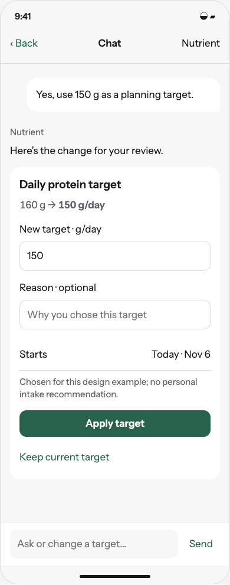
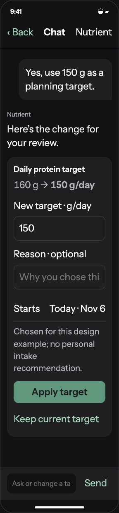
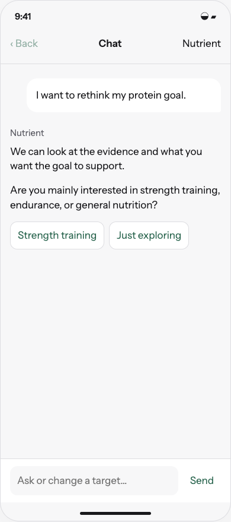
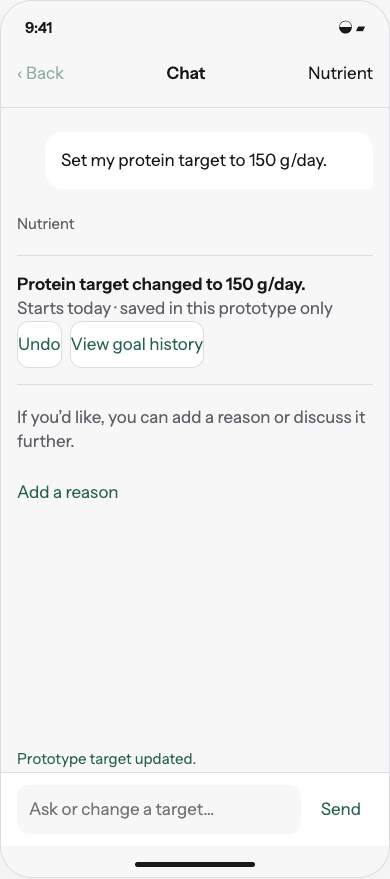

# Design chat-driven settings changes, goal history, and date-range analysis

6 November 2026 · First implementation · [Implementation issue](https://github.com/kggreco11/nutrient/issues/1)

Let users explore goals conversationally, request a proposal when ready, or directly change an unambiguous setting. Give chat bounded, explicit access to recorded nutrition over time.

## Review artifact

Open [the interactive study](index.html) through a local HTTP server from the repository root. This is a browser reference for native SwiftUI, not shipping UI. All diary and personal-decision data is synthetic. The prototype runs in memory, makes no model calls, and cannot change app settings. Each scenario is directly selectable; the primary actions also connect the flow.

```sh
python3 -m http.server 5198 --bind 127.0.0.1
```

Open `http://127.0.0.1:5198/design/2026-11-06/chat-goals/`.

## Design intent

A conversation before a proposal. Start with the question. Let the user choose when to turn the discussion into a settings change. A direct request takes the short route.

Domain: recorded days, intake, portions, reference intakes, personal targets, evidence provenance, goal decisions. Palette: the existing Field background/surface/ink/secondary/rule/fern assets; food-scale neutrals with fern actions. Signature: a nutrient quantity accompanied by its exact comparison basis and data coverage. Avoided defaults: unsolicited coaching cards, a green ideal-intake band, and a new home notification feed. Use existing Instrument Sans, 17 pt-equivalent body, 4 pt spacing rhythm and at least 44 pt controls; source and personal-decision depth is navigational rather than decorative.

## Behavior

```text
Explore → clarify only what matters → invite a proposal → user accepts → editable proposal → Apply target → receipt / Undo
Explicit setting request → validate → apply → receipt / Undo
Ask about history → select bounded period → compute locally/server-side → answer with dates and coverage
```

- Exploration must not auto-present a target proposal. Answer the question first; ask one useful clarification at a time, then offer to prepare a proposal. A request such as 'suggest a new target' authorizes drafting. Declining or ignoring the invitation changes nothing.
- An explicit unambiguous request such as 'Set my protein target to 150 g' authorizes the change, without a second confirmation or mandatory rationale interview. Persist successfully before saying it changed. Ambiguous units, dates, coupled settings, or material evidence-based risk require a focused clarification/review.
- An exploratory proposal is editable in chat, shows old/new value, units, effective date and optional rationale/source links, and writes only on Apply target. Food logging retains its existing Confirm & log contract.
- Direct change receipt: 'Protein target changed to 150 g/day.' Undo and optional 'Add a reason' / 'Discuss this' remain available; no forced engagement.
- Append versioned target changes with stable ID, old/new values, units, effective date, creation time, origin, optional user rationale, evidence version and optional conversation excerpt. Do not require saving an entire chat to remember a decision.
- Preserve historical target interpretation and diary/recipe snapshots. Existing history has no trustworthy goal dates: mark pre-migration goals as unknown rather than inventing history. New goals default to today; backdating is a separate explicit edit.
- Undo appends a compensating event; use expected target revision to prevent stale drafts and retries overwriting a later change. Commit selected changes atomically; no success receipt for failed persistence.
- Historical answers use an explicitly shown date range, recorded-day count, per-nutrient known/partial counts, target versions and food/supplement splits. Missing dates are not zero and incomplete records cannot establish deficiency.
- Use bounded date-range summaries with deterministic arithmetic and provenance; retrieve exact days only as needed. Do not send the entire diary automatically or expand tool permissions based on user preferences.
- Retain/loading/error/retry/offline and no-history states. Explain unavailable data honestly; changing or deleting logs invalidates derived summaries.

## Implementation map

NativeModels.swift owns target events and range summaries; NativeApp.swift owns proposal/receipt/history surfaces; NativeBackend.swift and server request schemas expose bounded context. Extend assistant policy and typed tools for settings actions without weakening meal logging, provenance or secret boundaries.

## Acceptance criteria for implementation

- [ ] Exploratory conversation cannot mutate settings or create a proposal before user acceptance; declining still permits useful discussion.
- [ ] Explicit valid setting request updates once, persists, gives accurate receipt and supports Undo; logging still requires explicit confirmation.
- [ ] Stale proposal, duplicate submission, failed save, unknown unit and risky target are handled without false success.
- [ ] Target history survives restart/export/import; historical dates preserve their prior interpretation and snapshots.
- [ ] Range calculation handles sparse dates, partial nutrients, changed targets and zero versus unknown without LLM arithmetic.
- [ ] Before shipping, build and exercise SwiftUI on narrow iPhone, default/accessibility text, light/dark, keyboard and VoiceOver labels.

## Boundaries

No shipping mutations, model/tool changes or migration in this design PR. No automatic goal selection, background analysis, diagnoses or supplement prescribing.

No implementation issue is closed by this design PR. Preserve the diary and historical recipe snapshots. The root AGENTS.md and app-owned assistant workflow remain unchanged. See [validation](validation.md) for the checks actually performed.

## Visual review

 

 

## Related work

- [Chat goals and historical context](https://github.com/kggreco11/nutrient/issues/1)
- [Nutrient evidence and baselines](https://github.com/kggreco11/nutrient/issues/2)
- [Optional reports](https://github.com/kggreco11/nutrient/issues/3), dependent on historical context and baseline metadata
- [Assistant response preferences](https://github.com/kggreco11/nutrient/issues/4), a later feature with protected app workflows
