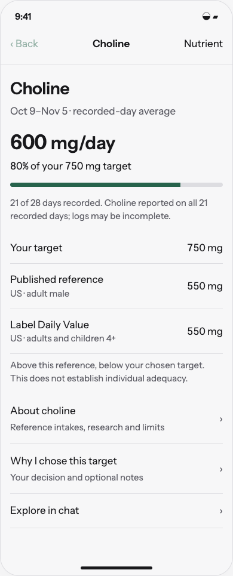
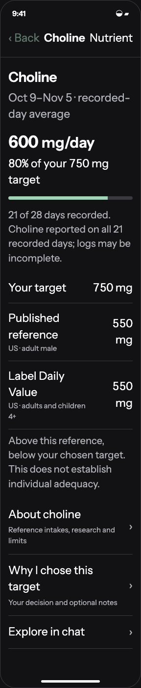

# Design nutrient explanations, evidence drill-down, and baseline comparisons

6 November 2026 · First implementation · [Implementation issue](https://github.com/kggreco11/nutrient/issues/2)

Make every target understandable through general evidence and a separate personal decision history, with contextual chat that can explore either without requiring a settings change.

## Review artifact

Open [the interactive study](index.html) through a local HTTP server from the repository root. This is a browser reference for native SwiftUI, not shipping UI. All diary and personal-decision data is synthetic. The prototype runs in memory, makes no model calls, and cannot change app settings. Each scenario is directly selectable; the primary actions also connect the flow.

```sh
python3 -m http.server 5198 --bind 127.0.0.1
```

Open `http://127.0.0.1:5198/design/2026-11-06/nutrient-evidence/`.

## Design intent

A target you can understand. Personal goals, published references and research have different meanings. Keep the explanation close, and let the user choose how deep to go.

Domain: recorded days, intake, portions, reference intakes, personal targets, evidence provenance, goal decisions. Palette: the existing Field background/surface/ink/secondary/rule/fern assets; food-scale neutrals with fern actions. Signature: a nutrient quantity accompanied by its exact comparison basis and data coverage. Avoided defaults: unsolicited coaching cards, a green ideal-intake band, and a new home notification feed. Use existing Instrument Sans, 17 pt-equivalent body, 4 pt spacing rhythm and at least 44 pt controls; source and personal-decision depth is navigational rather than decorative.

## Behavior

```text
Today / Trends / Settings → nutrient detail → About this nutrient / Why this target? → evidence summary → source
Nutrient detail → Explore in chat → optional saved note → optional goal discussion
```

- Provide one shared nutrient detail route from Today, Trends and Settings. Prioritize recorded intake, target and food contributions before deeper explanations.
- Keep general explanations ('About choline') separate from personal rationale ('Why I chose 750 mg'). Chat can optionally save an editable explanation or note without creating a target or claiming it is reviewed evidence.
- Separately label personal target, population-specific RDA/AI, label Daily Value, research findings and applicable upper limits. Baselines have authority, jurisdiction, age/life-stage applicability, unit, intake-source scope, publication version and checked date.
- Do not show one ideal green band from RDA to UL. Research dose/range, reference recommendation and user choice remain distinct. No proven higher range is an acceptable result.
- Example fixture: 600 mg recorded choline / 750 mg personal target = 80%; separate 550 mg adult male AI and US label DV. This comparison does not establish individual adequacy. All fixture data is synthetic.
- Evidence summaries explain population, intervention/exposure, outcome, study design, limitations and applicability. Distinguish biomarker outcomes from performance or long-term health; distinguish dietary intake from supplement dose.
- Each source drill-down has title, publisher, year, stable URL/DOI, reviewed/checked date and a claim-linked summary. Citation verification is required; unsupported model text is not promoted into a sourced fact.
- Risk messaging uses applicable source/form/population and jurisdiction. B12 having no established UL does not establish unrestricted safety; never generalize to other B vitamins. Magnesium source scope and differing B6 authorities are explicit.
- Allow ordinary tracking-target overrides with clear acknowledgement where relevant; actual intake can always be recorded accurately. A hard restriction on assisted target-setting requires a separately reviewed, sourced policy; neither model intuition nor crossing a UL invents a universal toxicity cutoff.
- Notification/digest preferences may mute reminders; they do not delete factual reference rows or make an evidence-based risk statement false. Historical evidence snapshots are versioned, and withdrawn or stale sources are labeled.
- Empty, unknown, partial, unavailable source, and conflicting-reference states are visible. Users can read general education without being pushed toward changing a target.

## Implementation map

Extend nutrient catalog with versioned reference/evidence records, not parallel untyped target numbers. Add native nutrient detail navigation and an explicit personal-note/decision link; preserve current unknown-value semantics.

## Acceptance criteria for implementation

- [ ] All entry points reach the same nutrient view; general education works without any saved decision.
- [ ] 600/750 displays 80% of personal target alongside the labeled reference, without diagnosing inadequacy.
- [ ] Source drill-down and contextual chat preserve nutrient, date range and evidence identity; back navigation restores context.
- [ ] Partial intake and missing source-specific composition cannot produce false below-limit reassurance.
- [ ] User-authored/chat notes are editable/deletable and distinct from curated evidence; no silent target mutation.
- [ ] Before shipping, verify native iPhone layout, Dynamic Type, light/dark, source navigation, loading/errors and accessibility.

## Boundaries

No clinical diagnosis, supplement dose recommendation, universal optimum, research search service or shipping nutrient UI in this design PR.

No implementation issue is closed by this design PR. Preserve the diary and historical recipe snapshots. The root AGENTS.md and app-owned assistant workflow remain unchanged. See [validation](validation.md) for the checks actually performed.

## Evidence used to constrain the design

These are reference checks, not a new systematic review. Checked 6 November 2026.

- [NIH ODS choline fact sheet](https://ods.od.nih.gov/factsheets/Choline-HealthProfessional/): adult male AI 550 mg/day; US label DV 550 mg; adult 19+ UL 3,500 mg/day. These are different constructs even when numbers coincide.
- [NIH ODS magnesium fact sheet](https://ods.od.nih.gov/factsheets/magnesium-healthProfessional/): adult 350 mg UL concerns supplemental/medication magnesium, not naturally occurring food magnesium. Source scope must be represented in data and copy.
- [NIH ODS B6 fact sheet](https://ods.od.nih.gov/factsheets/VitaminB6-HealthProfessional/): discusses neuropathy and differing authority limits, including EFSA's 12 mg/day adult UL. A high percentage must not be generalized across B vitamins.
- [NIH ODS FAQ](https://ods.od.nih.gov/HealthInformation/ODS_Frequently_Asked_Questions/): B12 has no established upper limit. The design must not translate that into proof that every dose is safe or useful.

Choline fixture amounts (600/750 mg), personal notes and diary coverage are illustrative, not recommended goals. Prototype claims remain deliberately limited to the reference distinctions above.

## Visual review

 

## Related work

- [Chat goals and historical context](https://github.com/kggreco11/nutrient/issues/1)
- [Nutrient evidence and baselines](https://github.com/kggreco11/nutrient/issues/2)
- [Optional reports](https://github.com/kggreco11/nutrient/issues/3), dependent on historical context and baseline metadata
- [Assistant response preferences](https://github.com/kggreco11/nutrient/issues/4), a later feature with protected app workflows

## Layout refinement · 6 November 2026

The shared design contract now records the user’s preference for content-sized action buttons, text grouped without decorative vertical accent rails, compact phone overviews, and plain-language reference labels. Navigation and selectable data rows retain full-row hit areas. Native implementation and iPhone validation remain outstanding.
