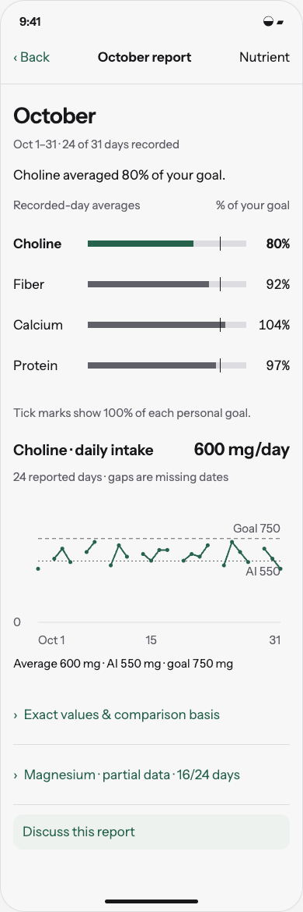
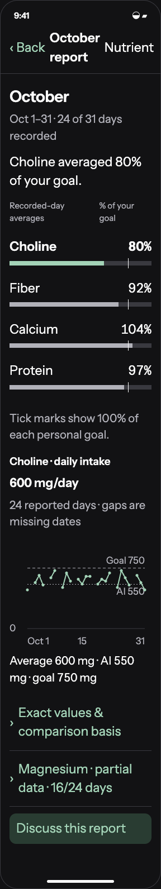

# Design optional nutrition reports and quiet trend reminders

6 November 2026 · Later feature · [Implementation issue](https://github.com/kggreco11/nutrient/issues/3)

Offer stored weekly/monthly in-app reports under Trends, with optional low-frequency notifications that respect incomplete logging and distinguish personal goals from reference intakes.

## Review artifact

Open [the interactive study](index.html) through a local HTTP server from the repository root. This is a browser reference for native SwiftUI, not shipping UI. All diary and personal-decision data is synthetic. The prototype runs in memory, makes no model calls, and cannot change app settings. Each scenario is directly selectable; the primary actions also connect the flow.

```sh
python3 -m http.server 5198 --bind 127.0.0.1
```

Open `http://127.0.0.1:5198/design/2026-11-06/nutrition-reports/`.

## Design intent

Chart-first reports with high information density and low reading burden. Start with a compact nutrient comparison and one selected daily series. Use one short takeaway; let charts carry the quantities and relationships. Explanations, sources, methods and exact values open on demand.

Domain: recorded days, intake, portions, reference intakes, personal targets, evidence provenance, goal decisions. Palette: the existing Field background/surface/ink/secondary/rule/fern assets; food-scale neutrals with fern actions. Signature: a nutrient quantity accompanied by its exact comparison basis and data coverage. Avoided defaults: unsolicited coaching cards, a green ideal-intake band, and a new home notification feed. Use existing Instrument Sans, 17 pt-equivalent body, 4 pt spacing rhythm and at least 44 pt controls; source and personal-decision depth is navigational rather than decorative.

## Report composition

- Initial view: period and recorded-day count; one short takeaway; aligned nutrient comparisons on a shared personal-goal percentage scale; one selected nutrient's daily series.
- Tap a nutrient row to change the daily chart. Show directly labeled goal/reference lines and units. Keep missing dates as actual gaps; never connect across missing dates or draw zeros.
- Display unreported composition as a compact partial-data row, not a false low-intake chart. Recorded-day coverage does not imply complete food logging.
- Place exact daily values, comparison methods, interpretation and source links behind disclosure. Do not duplicate every plotted number in narrative paragraphs.
- Percentages derive from the same synthetic daily arrays shown in the exact-value table. Choline: 600/750 = 80%; fiber: 32.2/35 = 92%; calcium: 1,040/1,000 = 104%; protein: 155.2/160 = 97%. All targets are illustrative personal choices.
- Sparse-data reports use a compact recorded/missing-date strip and one status sentence. No fabricated comparisons.
- On larger text, comparison labels and marks stack; exact values remain available to assistive technology. Native implementation should use Swift Charts and provide native chart accessibility and exact-value navigation.

## Behavior

```text
Trends → Reports → period report → nutrient / evidence / contextual chat
Report preferences → Off / Weekly / Monthly → optional notification opt-in
```

- Reports live under Trends → Reports, away from the Today priorities. Store period snapshots with computed data, methodology version, goal/reference versions and evidence links; reports are native in-app content, not PDFs.
- Default proactive reports and notifications to off. Offer weekly or monthly generation, a manual on-demand report, separate push permission, quiet hours, pause, and per-nutrient topic suppression. Refusing push does not block in-app reports.
- Use deterministic aggregations before optional narrative generation. Each finding shows period, recorded-day denominator, nutrient-known/partial counts and comparison basis. Never assume recorded days are complete intake.
- Candidate qualification for review: at least 4 recorded days for a week or 12 for a month, nutrient fully reported on at least 75% of recorded days, and recorded average below 90% of the applicable personal target. These are tunable product thresholds, not clinical criteria; partial records get a data-quality note instead of a confirmed shortfall.
- Cap a report at two salient findings. Weekly/monthly scheduler creates at most one notification per report, with no unchanged shortfall reminders between reports. Apply global/per-topic suppression, deduplicate by report ID and honor chosen quiet hours.
- Below personal target but above a reference is a comparison with a chosen goal, not evidence of deficiency. Do not prioritize a mildly missed custom target over a meaningful source-scoped limit issue.
- Compare source-scoped upper limits with the matching contribution only and show total/food/supplement portions. Partial intake may establish an exceeded limit when known intake alone exceeds it, but cannot establish being below it.
- No diagnosis, treatment inference, forecast, food/supplement recommendation or automated target change. Open-ended follow-up happens only when the user opens chat.
- Reports show the actual goals in effect per day. Mixed-goal periods show daily-normalized comparisons, not one current target pasted across history; no retrospective rewriting.
- Editing/deleting diary data marks affected reports out of date and offers regeneration with a new version. Keep no stale private text after data deletion/export cleanup; report removal and preference changes remain available.
- If insufficient data, store an honest sparse-data report and send no shortfall push. Notification previews are generic by default; no nutrient/health details on a lock screen. Generated narrative is versioned and removable.
- Scheduling, background execution, storage cost and iOS notification behavior need a separate implementation plan and native permission testing; no automation is created by this design task.

## Implementation map

Build on bounded historical context and target history from chat-goals, and reference metadata from nutrient-evidence. Separate deterministic report facts, optional narrative and delivery scheduling. No always-on model analysis.

## Acceptance criteria for implementation

- [ ] The report is understandable from charts and direct labels with at most one short initial takeaway; prose details are optional.
- [ ] All four nutrient selections update the daily series and exact-value table; missing dates break the line, and partial values cannot appear as zero or a complete percentage.
- [ ] Off creates no jobs, model calls or pushes; notification denial still permits report reading/manual generation.
- [ ] Sparse/partial fixtures yield data-quality copy, never zero-filled deficiency claims.
- [ ] Choline custom-target example shows both 80% personal-target comparison and the distinct reference.
- [ ] Deduplication, pause, quiet hours, unchanged-state suppression and per-topic controls prevent repeated nudges.
- [ ] Old reports retain stated period and calculation versions; edited/deleted logs correctly invalidate/remove affected data.
- [ ] Before shipping, verify native Reports navigation, accessibility, empty/loading/failure states and notification permissions.

## Boundaries

No background monitor, push scheduling, PDF, Whoop integration, home feed, model job or shipping report feature in this design PR.

No implementation issue is closed by this design PR. Preserve the diary and historical recipe snapshots. The root AGENTS.md and app-owned assistant workflow remain unchanged. See [validation](validation.md) for the checks actually performed.

## Evidence used to constrain the design

These are reference checks, not a new systematic review. Checked 6 November 2026.

- [NIH ODS choline fact sheet](https://ods.od.nih.gov/factsheets/Choline-HealthProfessional/): adult male AI 550 mg/day; US label DV 550 mg; adult 19+ UL 3,500 mg/day. These are different constructs even when numbers coincide.
- [NIH ODS magnesium fact sheet](https://ods.od.nih.gov/factsheets/magnesium-healthProfessional/): adult 350 mg UL concerns supplemental/medication magnesium, not naturally occurring food magnesium. Source scope must be represented in data and copy.
- [NIH ODS B6 fact sheet](https://ods.od.nih.gov/factsheets/VitaminB6-HealthProfessional/): discusses neuropathy and differing authority limits, including EFSA's 12 mg/day adult UL. A high percentage must not be generalized across B vitamins.
- [NIH ODS FAQ](https://ods.od.nih.gov/HealthInformation/ODS_Frequently_Asked_Questions/): B12 has no established upper limit. The design must not translate that into proof that every dose is safe or useful.

Choline fixture amounts (600/750 mg), personal notes and diary coverage are illustrative, not recommended goals. Prototype claims remain deliberately limited to the reference distinctions above.

## Visual review

 

## Related work

- [Chat goals and historical context](https://github.com/kggreco11/nutrient/issues/1)
- [Nutrient evidence and baselines](https://github.com/kggreco11/nutrient/issues/2)
- [Optional reports](https://github.com/kggreco11/nutrient/issues/3), dependent on historical context and baseline metadata
- [Assistant response preferences](https://github.com/kggreco11/nutrient/issues/4), a later feature with protected app workflows
